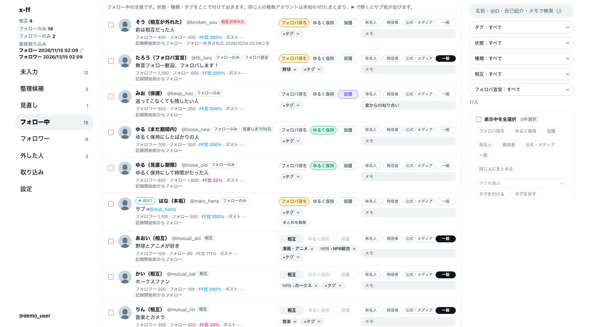

# x-ff

X（旧 Twitter）のフォロー・フォロワーを、自分の Mac の中だけで管理するツール。

<picture>
  <source media="(prefers-color-scheme: dark)" srcset="docs/screenshot-dark.png">
  
</picture>

ブラウザ拡張の [XPorter](https://chromewebstore.google.com/detail/jghmghialodmkmbcpfnhkgllkmjafmja) で自分のフォロー・フォロワーを JSON に出力し、それを取り込んで履歴として積み上げる。X に自動でアクセスしたり、フォローを自動で外したりはしない（データは自分で出力したファイルだけ。フォロー解除は画面から X のプロフィールを開いて自分で行う）。データは手元の SQLite に入り、外へは送らない。

- 新しくフォローした人は「未入力」に出し、種類とタグを付けてもらう
- フォロバ目的でフォローしたのに返ってこない人を「整理候補」として出す
- 返ってこなくてもフォローし続けたい人は「保護」、絶対ではない人は「ゆるく保持」にしておく（ゆるく保持は見直し期間がたつと「見直し」に出る）
- フォロー中の人に、複数のタグでジャンル分けをする（タグは木の形）
- どういう立場の人か（有名人・発信者・公式・メディア・一般）を「種類」として付ける（タグとは別）
- 同じ人の複数アカウント（本垢とサブ垢）を1行にまとめる。▶（e キー）で開くとサブ垢も並び、状態・種類・タグ・メモはアカウントごとに付けられる。まとめるときは一括操作の「同じ人にまとめる」か、未入力タブの「同じ人かも」の印（自己紹介でお互いの ID に触れている・プロフィールのリンク先が同じ組に出る）。サブ垢の「本垢から貼り付け」で本垢の種類とタグをコピーできる
- 外した人の記録を残し、「外した人」で見られる

x-ff は X Corp. や XPorter とは関係のない、個人が作ったツール。XPorter などの拡張機能で X のデータを書き出すことが X の規約に合うかは、使う人が確かめてほしい。

## 使い方

Node.js 24 以上が必要。依存パッケージはないので、`npm install` は要らない。

```sh
git clone https://github.com/zerollpaper/x-ff.git
cd x-ff
npm start
```

表示された http://localhost:4870 をブラウザで開く。まずは架空のアカウントだけの試し用データで動きを見るなら `npm run demo`（4880 番で開く。本物のデータには触らない）。

1. XPorter で、自分のプロフィールのフォローとフォロワーを **JSON** で出力する（CSV は ID が壊れやすいので使わない）。
2. 出力したファイルを、ファイル名を変えずに x-ff の画面へドラッグ＆ドロップする。フォローとフォロワーは同じときに出力したものを一緒に入れる。`npm start -- --watch` で起動しておくと、ダウンロードフォルダに保存された時点で自動で取り込まれ（取り込んだファイルはダウンロードフォルダから消す。別のアカウントのものなど取り込めなかったファイルは残る）、開いている画面も15秒以内に更新される。
3. 「未入力」に出た人（フォロー中で、種類かタグがまだない人）に種類とタグを付ける。両方付けると「入力済み」になり、タブを移ると未入力からいなくなる（入力している間は消えない）。
4. 「フォロー中」で状態（フォロバ待ち・ゆるく保持・保護）、種類、タグを付ける。
5. 「整理候補」に出た人は、外すなら X で開いて自分でフォロー解除する（次の取り込みで「外した人」に移る）。残すなら状態ボタンを押す：「まだ待つ」で猶予期間を数え直す、「ゆるく保持」「保護」で残す。どれを押しても整理候補からいなくなる。
6. 「見直し」に出た人（ゆるく保持にして見直し期間がたった人）は、「まだ保持」で見直し期間を数え直す、「フォロバ待ち」で猶予期間を始め直す、「保護」でずっと残す。
7. 「外した人」でもう見なくていい人は「外した人から消す」で一覧から外せる（記録は残る）。

X はフォローした日時を出さないので、「初めて一覧に出た取り込みの日時」をフォロー開始日として使う。定期的に出力して取り込むほど、フォロー開始日・外した日・相互が外れた日が正確になる。

取り込み済みの記録は、フォロー開始日・外した日・相互が外れたことを判断する履歴なので消さない（間違えて取り込んだものだけ消す）。

### 画面

- **並び**：幅が1600px以上の画面では、左にタブ・真ん中に一覧・右に検索と絞り込みとまとめて操作の3列になる。それより狭い画面やスマホでは1列。
- **各行**：アイコン（未設定の人は X の標準アイコン。読み込めなければ壊れた印）・名前・@ID・自己紹介（3行まで）と、フォロワー・フォロー・FF比（フォロワー ÷ フォロー）・ポスト・フォロー開始の行。FF比は設定の幅（初めは80〜125%）より上なら青、下ならピンク、幅の中は灰色。
- **全文のカード**：自己紹介かフォロワー数などの行にマウスを乗せる（スマホでは押す）と、自己紹介の全文・プロフィールのリンク・フォロワー数などの行をカードで出す。
- **リンク**：自己紹介の URL・メールアドレス・@ID はリンクになる（メールアドレスは押すとメールのアプリで新しいメールを作る）。リンクに付いた追跡用の文字（utm_…、Instagram の igsh、YouTube の si、X の s・t など）は外して出す（保存してあるデータはそのまま。X が短くした t.co のリンクは外せない）。
- **タグを付ける**：各行の「+タグ」（まとめて操作では「タグを選ぶ」）から選ぶ。下の段があるタグと、もう付いているタグは選べない。いちばん下の「＋新しいタグを作る…」で新しいタグを作れる。
- **キー操作**：一覧では ↓↑（j/k）で移動し、数字キーで状態・種類を付けられる（キーの一覧は「設定」のいちばん下）。

### 設定

- **猶予期間・見直し期間・FF比の色の幅・タグの名前と上の分類**を変えられる。データと一緒に保存されるので、Mac でもスマホでも同じ。
- **自分のアイコン**：取り込むファイルには自分のプロフィールが入っていないので、X で自分のアイコンの画像アドレスをコピーして貼る（`https://pbs.twimg.com/profile_images/…` だけを受け付ける）。自分の @ID の横（3列のときは左の列のいちばん下）に出る。
- **テーマ**（自動・ライト・ダーク）：自動は Mac の設定に合わせる。選んだものはそのブラウザにだけ覚える。
- **タグの表**：表の上の欄で、誰にも付けずに新しいタグを作れる（上の分類も選べるので、分類を先に用意してから人を振り分けられる）。名前の列に親子・兄弟のつなぎの線を出し、下の段があるタグは ▼／▶ でたたむ（「全部開く」「全部たたむ」もある。たたんだものはそのブラウザに覚える）。

コマンドから取り込むこともできる：`npm run import -- XPorter_following_....json XPorter_followers_....json`

### スマホから使う

`npm start -- --lan` で起動すると、同じ Wi-Fi のスマホからも使える。

1. Mac で「設定 › スマホから使う」を開くと、合言葉付きのアドレスが出る（起動したときのターミナルにも出る）。
2. そのアドレスをスマホで開く（AirDrop やメモで送るか、QR コードにして読み取る）。合言葉がブラウザに記憶され、以後はアドレスだけで開ける。Safari の「ホーム画面に追加」でアプリのように使える。

- 合言葉は `data/.lan-token`。変えたいときはこのファイルを消してサーバーを起動し直し、新しいアドレスを開き直す。
- Mac からの接続は合言葉なしで使える。スマホなどほかの端末からは、データ（`/api/`）に合言葉が要る。受け付けるのは localhost・IP アドレス・`.local` のホスト名だけ。
- `--lan` を付けずに起動したときは、この Mac からだけ使える。

### 常駐させる（macOS）

`./serve.sh` は `--lan`（スマホから使う）と `--watch`（ダウンロードフォルダの自動取り込み）を付けて起動し、動いている間は Mac がスリープしないようにする（`caffeinate`）。launchd などに登録しておくと、ログインしたときから使える。

## テスト

```sh
npm test
```

## ライセンス

MIT
